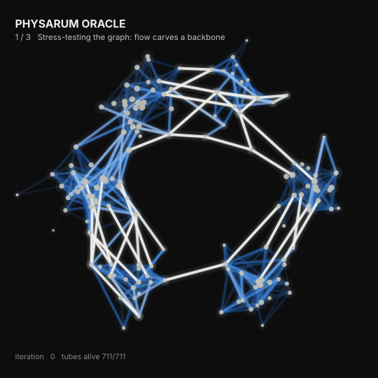
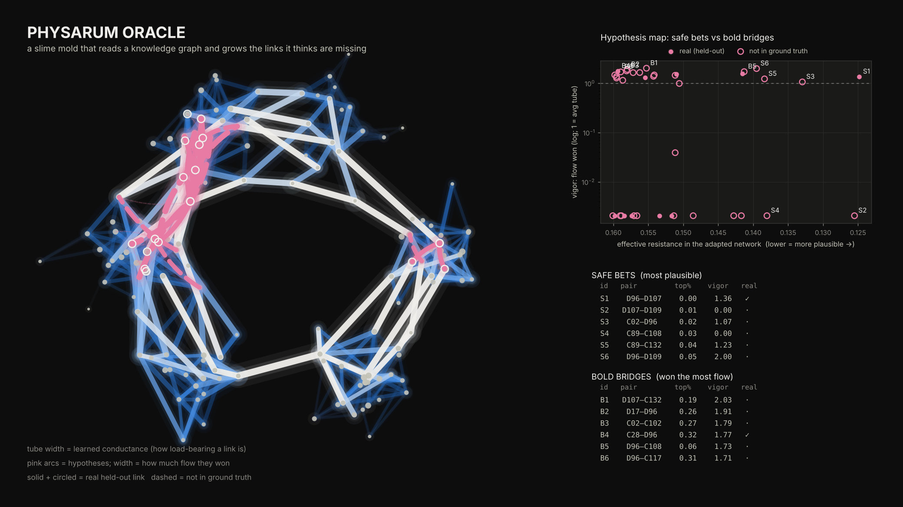
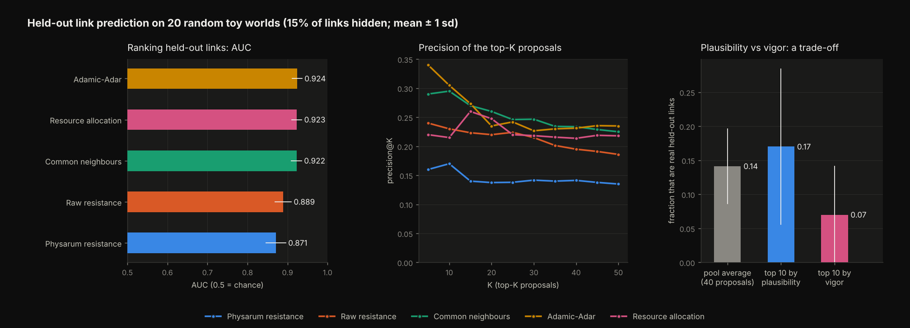

# Physarum Oracle

**A slime mold that reads a knowledge graph and grows the links it thinks are missing.**





## The idea in one minute

*Physarum polycephalum* is a single-celled slime mold that solves mazes and designs
efficient transport networks (it famously reproduced the Tokyo rail map). It does this
with one local rule: **tubes that carry a lot of flow get thicker, tubes that carry
little wither.**

The Oracle treats a knowledge graph (concepts as nodes, established relationships as
edges) as the body of that organism and asks what it would grow.

1. **Stress-test.** Random "demand" (concept *s* needs to reach concept *t*) pushes
   current through the graph, solved exactly with Kirchhoff's laws. Edges adapt using a
   Tero-style rule, `dD/dt = f(|Q|/mean|Q|) - mu*D`, with total tube mass conserved
   (the organism has a fixed budget). The result is a learned **backbone**: which
   existing links are load-bearing.
2. **Propose.** Every missing link is scored by *effective resistance* in the adapted
   network. If the organism already routes easily between two concepts, a direct link
   is plausible.
3. **Select.** The top 40 proposals are seeded as thin tubes and the organism runs
   again under the same demand. Hypotheses compete for flow; some thicken (**vigor**
   above 1 means as strong as an average backbone tube), others starve to nothing.

Output: a ranked hypothesis list with two numbers per proposal, **plausibility** and
**vigor**, plus a picture of the organism thinking. The two axes split proposals into
**safe bets** (very plausible) and **bold bridges** (win a lot of flow, i.e. would
carry a lot of traffic if they existed).

## Run it

```bash
pip install -r requirements.txt                     # numpy, matplotlib, pillow (Python 3.10+)
python physarum_oracle.py demo                      # GIF + hero figure + hypotheses.csv (~15 s)
python physarum_oracle.py benchmark --seeds 20      # held-out evaluation vs baselines (~15 s)
python physarum_oracle.py tune                      # the validation-seed grid search
python physarum_oracle.py discover --edges my.csv   # your own graph: two columns, concept_a,concept_b
```

`discover` takes the largest connected component, lays it out with a small built-in
spring layout, and writes `hypotheses.csv` and `oracle_map.png` (add `--gif` for the
animation). It uses dense linear algebra, so it is comfortable up to a few hundred or
low thousands of nodes; a sparse solver would be the next step beyond that.

## Honest results (please read)

I evaluated the way you would evaluate any link predictor: build a toy world of 150
concepts in 6 "fields" (about 800 links, dense inside a field and sparse across fields),
hide 15% of links (never disconnecting the graph), run the method on the rest, and ask
how highly it ranks the hidden links among all ~11,000 missing pairs. 20 random worlds
(seeds 0-19), none of which were used for tuning.



| Method | AUC (mean ± sd) | precision@10 |
|---|---|---|
| Adamic-Adar | 0.924 ± 0.013 | 0.31 |
| Resource allocation | 0.923 ± 0.012 | 0.21 |
| Common neighbours | 0.922 ± 0.013 | 0.30 |
| Raw resistance (no adaptation) | 0.889 ± 0.020 | 0.23 |
| **Physarum resistance (this project)** | **0.871 ± 0.025** | 0.17 |

**What this says:**

- **The Oracle does not beat the classic heuristics at predicting links.** It loses to
  Adamic-Adar in 20 of 20 worlds (mean AUC gap -0.053). It is also slightly *worse* than
  plain effective resistance without adaptation. On validation seeds, the more
  the organism was allowed to reshape the network, the more AUC dropped: the best
  validation AUC came from settings where adaptation is almost switched off. I shipped
  settings with a clearly adapted backbone (strongest tubes about 4x the weak ones)
  because the backbone is the point of the project, and I am telling you it costs
  accuracy.
- **It is far better than chance.** In the demo world, 10 of the 40 proposals (25%) are
  real links the model never saw, against a base rate of 1.2%.
- **Vigor is not a better truth detector; it points the other way.** Inside the top-40
  pool, the 10 highest-vigor proposals are real 7% of the time, below the pool average
  of 14% (correlation between log vigor and being real: -0.14). That makes sense:
  proposals that win the most flow are the ones that would reroute a lot of traffic,
  which are the long, surprising shortcuts, and surprising shortcuts are less likely to
  be real in this world. So I present vigor as a **second axis (how much it would
  matter)**, not as a confidence boost.
- **Caveats.** The toy world is geometric, so closing triangles is an unusually good
  strategy and favours the neighbour heuristics. Real knowledge graphs differ, and I
  have not tested on one. Hidden links are only a proxy for true discoveries.

Development notes, since they shaped the design: my first version (unnormalised flow, no
mass conservation) pruned about half the tubes to zero and scored AUC 0.61. Conserving
tube mass and making the growth rule scale-free fixed that. Hyper-parameters were
chosen on separate validation seeds (1000+), and when a design choice (combining
plausibility and vigor into one rank) tested worse on validation, I dropped it.

## Files

| File | What it is |
|---|---|
| `physarum_oracle.py` | Everything: world generator, organism, baselines, evaluation, plotting, CLI |
| `outputs/organism.gif` | The organism: backbone grows, hypotheses seeded, selection, ground-truth reveal |
| `outputs/oracle_map.png` | Final backbone, hypothesis arcs, the safe-vs-bold map, top proposals |
| `outputs/benchmark.png`, `benchmark_results.json` | Held-out comparison on 20 worlds |
| `outputs/hypotheses.csv` | All 40 proposals with plausibility, vigor, bucket, and ground truth (demo only) |
| `outputs/toy_world_edges.csv` | The demo graph as an edge list, to try `discover` on |

## Tests and license

```bash
python -m unittest discover -s tests -v   # fast sanity tests; also run in CI
```

MIT licensed (see `LICENSE`; edit the copyright line to your name before publishing).
The pictures in `outputs/` are regenerated by `demo` and `benchmark`; results depend on
the seeds in the commands above.

## Where I would take it next (untested)

The demand here is random, so vigor measures generic usefulness. The more interesting
version makes demand a **question**: pour flow from "gene X" to "disease Y" and see
which missing links the organism grows to serve that question. Vigor would then mean
"this hypothesis would connect what you care about", which is a meaningful, different
signal from plausibility. I have not built or tested that.
